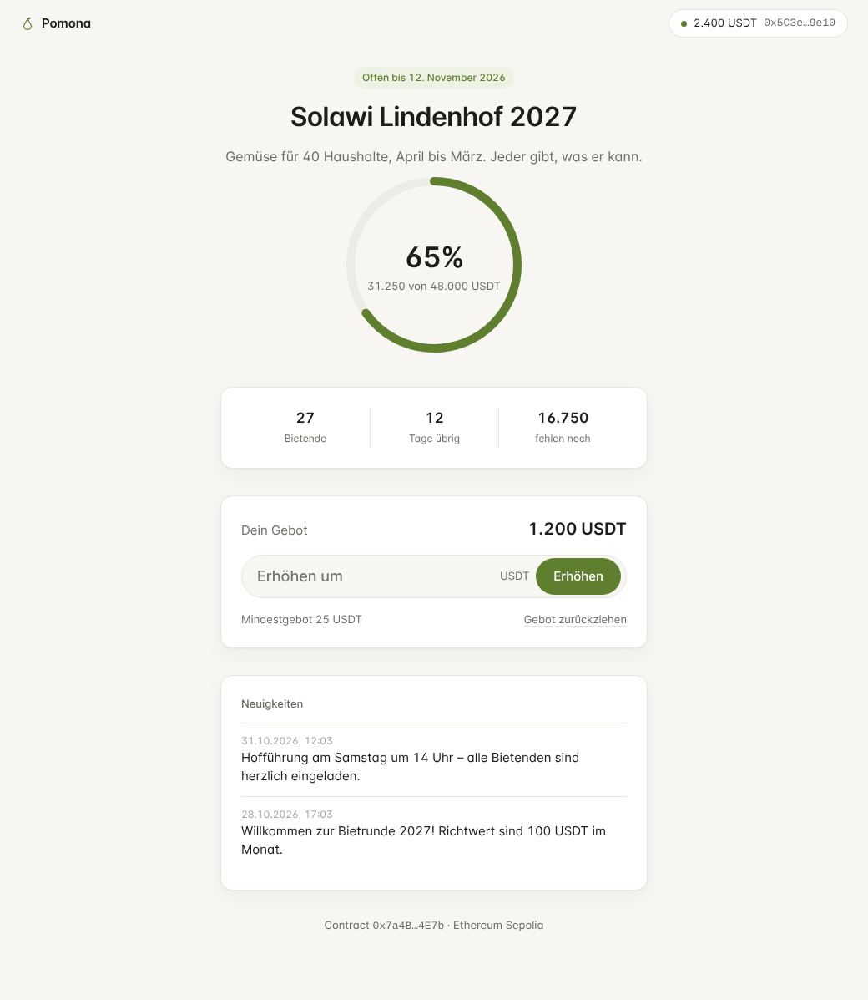

# Pomona

**Dezentrale Bietrunde auf Tethers Stack.** Jemand startet eine Runde mit einem Zielbetrag und teilt einen Link. Wer mitmacht, bietet direkt aus der eigenen Wallet. Das Geld liegt bis zum Ende in einem Escrow-Contract: Wird das Ziel erreicht, zahlt der Contract an das Projekt aus, sonst holt sich jeder seinen Betrag zurück. Es gibt keinen Server, keinen Account und niemanden, dem man das Geld anvertrauen muss.

Pomona ist der Nachfolger von [Contrib](https://github.com/pbrandl/contrib) (Flutter + Parse Server) und als technisches Vorzeigeprodukt gedacht.



## Wie es funktioniert

| Schicht | Technik | Aufgabe |
|---|---|---|
| **Desktop-App** | [Pear](https://pears.com) (`pear-electron`) | Oberfläche, startet einen Bare-Worker |
| **P2P** | Hyperswarm, Corestore, Hyperbee | Der Organisator schreibt das *Manifest* (Titel, Beschreibung, Contract-Adresse, Neuigkeiten) in einen Hyperbee. Jeder Teilnehmer repliziert und **seedet** es mit, so bleibt die Runde erreichbar, auch wenn der Organisator offline ist. |
| **Wallet** | [WDK](https://docs.wdk.tether.io) (`@tetherto/wdk`, `wdk-wallet-evm`) | Self-custodial. Die Seed-Phrase bleibt auf dem Gerät, in einem lokalen Hyperbee, der nie repliziert wird. Alle Transaktionen werden über WDK signiert. |
| **Geld** | `PomonaRound.sol` (Solidity, EVM) | Treuhand ohne Vertrauen: bieten, erhöhen, zurückziehen solange offen, Auszahlung nur bei erreichtem Ziel, sonst Rückzahlung. Keine Admin-Keys. |

### Ablauf

1. **Runde starten:** Der Organisator legt über `PomonaFactory.createRound` einen eigenen `PomonaRound`-Contract an (Token, Ziel, Deadline, Mindestgebot) und veröffentlicht das Manifest auf Hyperswarm.
2. **Teilen:** Der Einladungslink `pomona://…` enthält den Manifest-Key, das Netzwerk, die Contract-Adresse und bei Runden nur auf Einladung einen **Invite-Key**.
3. **Beitreten:** Die App lädt das Manifest peer-to-peer und prüft es gegen den Contract (Organisator-Adresse muss übereinstimmen).
4. **Bieten:** `approve` und `bid`. Das Geld liegt jetzt im Contract. Bieter können erhöhen oder ihr Gebot zurückziehen, solange die Runde offen ist.
5. **Ende:** Nach der Deadline ruft der Organisator bei erreichtem Ziel `claim()` auf und bekommt alles. Andernfalls ruft jeder Bieter `refund()` auf. Bricht der Organisator vorher mit `cancel()` ab, können ebenfalls alle ihr Geld zurückholen.

### Spam-Schutz im Contract

- **Mindestgebot:** Jedes Gebot bindet echtes Geld, mindestens `minBid`.
- **Nur auf Einladung:** Der Contract speichert die Adresse eines Invite-Keys. Den privaten Schlüssel dazu enthält nur der Einladungslink. Beim ersten Gebot signiert die App die eigene Adresse mit diesem Key (`inviteDigest` nach EIP-191), und der Contract prüft die Signatur. Ohne Link kann man nicht bieten, auch wenn die Contract-Adresse bekannt ist. Eine Signatur für eine andere Adresse lässt sich nicht wiederverwenden.

## Projektstruktur

```
contracts/        Solidity + Tests (solc-js, Hardhat-Node als lokale Chain)
  src/            PomonaRound, PomonaFactory, MockUSDT (nur Test)
  scripts/        build (Kompilieren), devchain (lokale Chain), deploy
app/              Pear-Desktop-App
  index.js        Pear-Einstieg (Bare): öffnet die Electron-UI
  worker/         Bare-Worker: Wallet, P2P, Chain. Die UI erreicht ihn nur über RPC
  core/           Logik (läuft in Node und Bare): pomona, wallet (WDK), round, p2p, invite, rpc
  ui/             Oberfläche: Vanilla JS + CSS, Hell/Dunkel
  test/           End-to-End-Tests (Chain + Hyperswarm-Testnet + Bare)
```

## Loslegen

Voraussetzungen: Node.js 22 und die [Pear-CLI](https://docs.pears.com) (`npm i -g pear`, danach einmal `pear`).

```bash
# 1. Contracts bauen und testen
cd contracts && npm install && npm test

# 2. Lokale Chain starten (Terminal 1) und Contracts darauf deployen (Terminal 2)
npm run chain
node scripts/deploy.js local           # schreibt app/core/deployments.js (Adressen)

# 3. App
cd ../app && npm install && npm test
pear run --dev .                        # Organisator
pear run --dev . --tmp-store            # zweite Instanz als Bieter
```

In der Wallet-Seitenleiste gibt es auf der lokalen Chain einen **Faucet** (Test-ETH + 5.000 Test-USDT).

### Testnet

```bash
cd contracts
RPC=https://ethereum-sepolia-rpc.publicnode.com PRIVATE_KEY=0x… node scripts/deploy.js sepolia
```

Auf Testnets wird `MockUSDT` mit öffentlichem `mint` mit-deployt. Für ein echtes USDT `TOKEN=0x…` setzen. In der App wählt der Organisator das Netzwerk beim Starten der Runde. Der Einladungslink trägt es an die Bieter weiter.

### Design-Vorschau ohne Pear

```bash
cd app && npm run preview   # http://localhost:4173/preview.html?s=bidder
```

Szenarien: `onboarding`, `start`, `bidder`, `organizer`, `succeeded`, `failed`.

## Tests

- `contracts`: 8 Tests: Erfolg und Auszahlung, verfehltes Ziel und Rückzahlung, Zurückziehen, Mindestgebot, Einladungs-Signaturen (fehlend, fremde Adresse, falscher Key), Abbruch, Parameterprüfung.
- `app`: End-to-End mit echter lokaler Chain, echtem WDK und Hyperswarm-Testnet: Runde anlegen, beitreten (auch wenn der Organisator offline ist, über einen anderen Peer), bieten, erhöhen, zurückziehen, auszahlen, Rückzahlung, Bieten ohne Einladung wird abgelehnt, Wallet wiederherstellen. Dazu ein Smoke-Test, der den Kern **in Bare** ausführt.

## Stand und nächste Schritte

- [x] Escrow-Contract, Factory, Spam-Schutz
- [x] Kern: WDK-Wallet, Contract-Client, Pears-Manifest, Einladungslinks
- [x] Pear-Desktop-UI
- [ ] Erster Start in Pear auf einem Desktop (in der Entwicklungsumgebung gab es kein Display und keinen Pear-Runtime-Download)
- [ ] Gasless über `wdk-wallet-evm-erc-4337` (Gebühren in USDT statt ETH)
- [ ] Seed verschlüsselt ablegen (Passwort oder OS-Keychain)
- [ ] Monatliche Rechnungen über Lightning (`wdk-wallet-spark`) mit QR-Beleg (Preimage)
- [ ] Telegram: Bot läuft in der App des Organisators, Mini-App zum Bieten
- [ ] Audit des Contracts vor jedem Mainnet-Einsatz

## Lizenz

MIT. Die Schrift Inter steht unter der SIL Open Font License.
