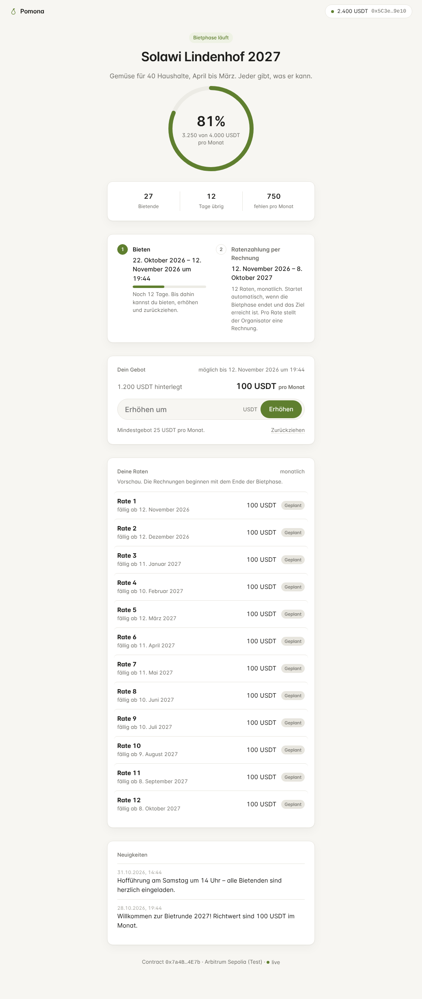
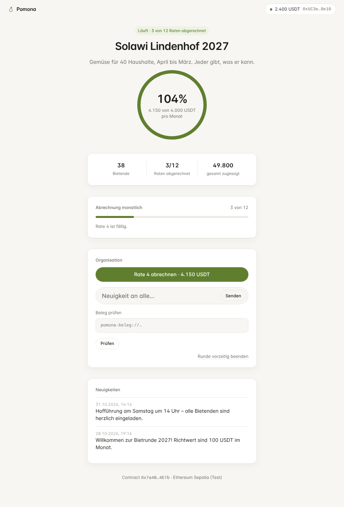
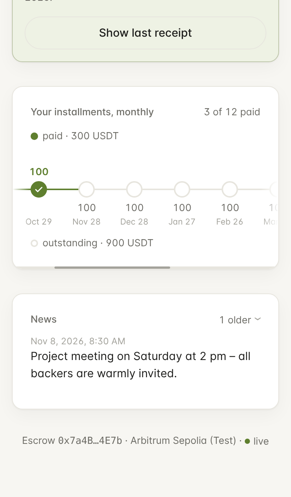
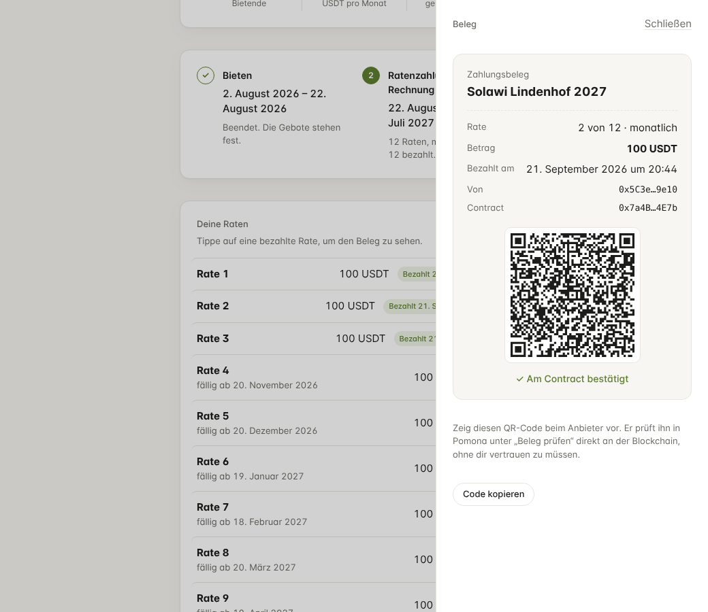

# Pomona

**Eine dezentrale Bietrunde auf Tethers Stack, nur in USDT.**

Jemand startet eine Bietrunde, zum Beispiel für eine Solawi, und legt fest: das Ziel pro Rate, ob wöchentlich oder monatlich abgerechnet wird, wie oft, und **wie bezahlt wird**. Dann teilt er einen Link. Wer mitmacht, bietet einen Betrag pro Rate.

**Per Rechnung** (Standard, gut für kleine Projekte): Bieten kostet nichts. Ist das Ziel erreicht, kommt jede Woche bzw. jeden Monat automatisch eine Rechnung. Jede bietende Person bezahlt sie mit einer Signatur aus ihrem Konto direkt an den Organisator und bekommt dafür einen Beleg. Ohne Zahlung gibt es keinen Beleg. Der Organisator sieht, wer bezahlt hat.

**Vorab hinterlegen** (Treuhand): Beim Bieten liegen alle Raten in einem Smart Contract.

- **Ziel verfehlt:** Alle bekommen ihr Geld zurück.
- **Ziel erreicht:** Der Organisator stellt Rate für Rate eine Rechnung, höchstens einmal pro Intervall und höchstens so oft wie festgelegt. Jede Rechnung zahlt eine Rate aus dem Contract an ihn aus.
- **Belege:** Für jede abgerechnete Rate bekommen die Bietenden einen Beleg als QR-Code, den jeder gegen die Blockchain prüfen kann.
- **Vorzeitiges Ende:** Was nicht abgerechnet wird, geht an die Bietenden zurück.

Es gibt keinen Server und keinen Account, und niemand muss einen anderen Token als USDT halten.

Pomona ist der Nachfolger von [Contrib](https://github.com/pbrandl/contrib) (Flutter + Parse Server) und als technisches Vorzeigeprodukt gedacht.



| Organisator rechnet ab | Ratenliste | Beleg als QR |
|---|---|---|
|  |  |  |

## Technik

| Schicht | Technik | Aufgabe |
|---|---|---|
| Desktop-App | [Pear](https://pears.com) (`pear-electron`, `pear-run`, `pear-pipe`) | Oberfläche im Renderer. Wallet, P2P und Chain laufen in einem Bare-Worker. |
| P2P | Hyperswarm, Corestore, Hyperbee | Der Organisator veröffentlicht das Manifest (Titel, Website, Neuigkeiten). Alle Teilnehmer replizieren und seeden es mit. |
| Wallet | [WDK](https://docs.wdk.tether.io): `wdk`, `wdk-wallet-evm-erc-4337` | Self-custodial Smart Account (Safe). Gebühren werden in USDT über einen Paymaster bezahlt, eine WDK-Policy begrenzt die Rechte. |
| Tresor | libsodium: Argon2id + XSalsa20-Poly1305 | Die Seed-Phrase wird nur verschlüsselt gespeichert. |
| Geld | `PomonaRound`, `PomonaFactory` (Solidity) | Escrow, Raten-Abrechnung und Belege, ohne Admin-Keys. |
| Assistent | [QVAC](https://qvac.tether.io) (`@qvac/inference`, llama.cpp) | „Frag Pomona“: erklärt die Runde und bereitet Schritte vor. Läuft lokal, Modell (Qwen3) wird einmalig peer-to-peer geladen. Bestätigen muss immer die Person. |

Mehr dazu:
- [docs/ARCHITECTURE.md](docs/ARCHITECTURE.md): Module, Abläufe und wie man Pomona erweitert
- [docs/CONTRACT.md](docs/CONTRACT.md): Phasen, Funktionen und Invarianten der Contracts
- [docs/SECURITY.md](docs/SECURITY.md): Bedrohungsmodell, Prüfungsergebnisse und offene Risiken
- [docs/RPC.md](docs/RPC.md): Schnittstelle zwischen UI und Worker, Format des Status
- [docs/DEV.md](docs/DEV.md): Entwicklermodus ohne Pear, Sprachmodell als Datei
- [docs/ASSISTANT.md](docs/ASSISTANT.md): der Assistent „Frag Pomona“ (QVAC), Werkzeuge, Grenzen, Sicherheit
- [docs/CONCEPT.md](docs/CONCEPT.md): Konzept (noch nicht umgesetzt): Rundentypen, Wallet-Dienst, Swap-Dienst

## Loslegen

Voraussetzungen: Node.js 22 und die [Pear-CLI](https://docs.pears.com) (`npm i -g pear`, danach einmal `pear` ausführen).

```bash
# Contracts bauen und testen (19 Tests)
cd contracts && npm install && npm test

# Lokale Chain (Terminal 1) und Deployment (Terminal 2)
npm run chain
node scripts/deploy.js local          # schreibt app/core/config/deployments.js

# App testen (36 Tests) und starten
cd ../app && npm install && npm test
pear run --dev .                      # Organisator
pear run --dev . --tmp-store          # zweite Instanz als Bieter
```

Im Entwicklermodus läuft die App gegen die lokale Chain. In der Wallet gibt es einen **Faucet** für Test-USDT. Die Gebühren in ETH füllt die App dort unsichtbar auf, weil es lokal weder Bundler noch Paymaster gibt.

### Ohne Pear (z. B. hinter einer Firmen-Firewall)

```bash
cd contracts && npm install && cd ../app && npm install
npm run dev     # lokale Chain, lokales P2P-Netz, Kern in Bare, zwei Profile im Browser
```

Derselbe Code wie in Pear, nur im Browser und komplett offline. Das Sprachmodell kommt dort als Datei aus `~/pomona-models`. Anleitung: [docs/DEV.md](docs/DEV.md).

### Testnet und Mainnet

1. Factory deployen:
   ```bash
   cd contracts
   RPC=https://ethereum-sepolia-rpc.publicnode.com PRIVATE_KEY=0x… node scripts/deploy.js sepolia
   ```
   Auf Testnets wird ein Test-USDT mit öffentlichem `mint` mitdeployt. Für echtes USDT `TOKEN=0x…` setzen.
2. In `app/core/config/networks.js` unter `aa` einen Bundler und einen **USDT-Token-Paymaster** eintragen, zum Beispiel von Candide oder Pimlico (siehe die [WDK-Konfiguration](https://docs.wdk.tether.io/sdk/wallet-modules/wallet-evm-erc-4337/configuration)).
3. Die App ohne `--dev` starten. Netzwerke, die nicht vollständig eingerichtet sind, lassen sich nicht auswählen.

### Design-Vorschau ohne Pear

```bash
cd app && npm run preview   # http://localhost:4173/preview.html?s=bidder
```

Szenarien: `onboarding`, `locked`, `start`, `bidder`, `organizer`, `invoice`, `receipts`, `completed`, `failed`. Per Rechnung: `payg-bidding`, `payg`, `payg-organizer`.

## Qualität

- `npm test` in `contracts/` umfasst 19 Tests: beide Bezahlarten (vorab hinterlegen, per Rechnung), Zeitplan, nachgeholte Rechnungen, Belege, Erstattung bei Abbruch, Ablauf und verfehltem Ziel, Einladungen (auch Wiederverwendung in einer anderen Runde), Fee-Tokens, Factory-Register und Parameterprüfung.
- `npm test` in `app/` umfasst 36 Tests:
  - Unit-Tests: Beträge, Links, Zeitplan, Policy, Tresor, Manifest-Bereinigung, RPC-Validierung, Benachrichtigungen
  - Assistent: Befehle, Wissen, Rollen- und Phasenprüfung jeder Aktion, Prompt Injection, keine Werkzeuge zum Geldbewegen
  - End-to-End mit echter Chain, WDK und Hyperswarm: Runde „Per Rechnung“ (Zahlung, fehlendes Guthaben, offene Rechnungen), Raten-Runde inklusive Beitritt bei offline Organisator, Belege, gefälschte Runden, Policy-Blockade, Senden und Sperren
  - ein Test, der den Kern **in Bare** ausführt, inklusive QVAC
- `npm run lint` in `app/` prüft den Code mit [standard](https://standardjs.com).

## Stand

- [x] Contracts mit Raten, Rechnungen, Belegen und Factory-Register
- [x] Nur USDT: ERC-4337 Smart Account mit Gebühren über den Paymaster (WDK)
- [x] Tresor, Sperre, WDK-Policy, CSP und Sicherheitsprüfung ([SECURITY.md](docs/SECURITY.md))
- [ ] Erster Start in Pear auf einem Desktop und Abgleich mit der aktuellen Pear-Doku
- [ ] Sepolia: Bundler und Paymaster eintragen und den kompletten Ablauf testen
- [ ] Automatische Sperre bei Inaktivität, stärkere Argon2id-Parameter
- [x] Assistent „Frag Pomona“ auf QVAC (lokal, nur vorbereitend)
- [ ] Assistent mit echtem Modell auf einem Desktop testen (Qualität auf Deutsch, Tool-Aufrufe)
- [ ] Telegram-Bot im Worker des Organisators
- [ ] Externes Audit vor dem Mainnet

## Lizenz

MIT. Die Schrift Inter steht unter der SIL Open Font License.

## Updates verteilen

Pear verteilt neue Versionen peer-to-peer unter demselben `pear://`-Link:

```bash
cd app
# vorher: Version in package.json und core/version.js erhöhen
pear stage production      # gleicher Link, neue Version
pear release production    # ab jetzt bekommen alle diese Version
pear seed production       # mindestens ein Rechner hält die App verfügbar
```

Laufende Apps laden das Update im Hintergrund und zeigen oben „Neue Version von Pomona ist bereit · Neu starten“ (`pear-updates`, `pear-restart`). Während einer laufenden Transaktion ist der Neustart gesperrt. Wallet, Runde und Belege bleiben erhalten, Contracts sind von App-Updates nie betroffen. Die Version steht im Konto-Bereich. Den Release-Schlüssel (im Pear-Verzeichnis) sicher verwahren: Wer ihn hat, kann allen Updates einspielen. Die Befehle bitte einmal gegen die aktuelle Pear-Doku prüfen.
