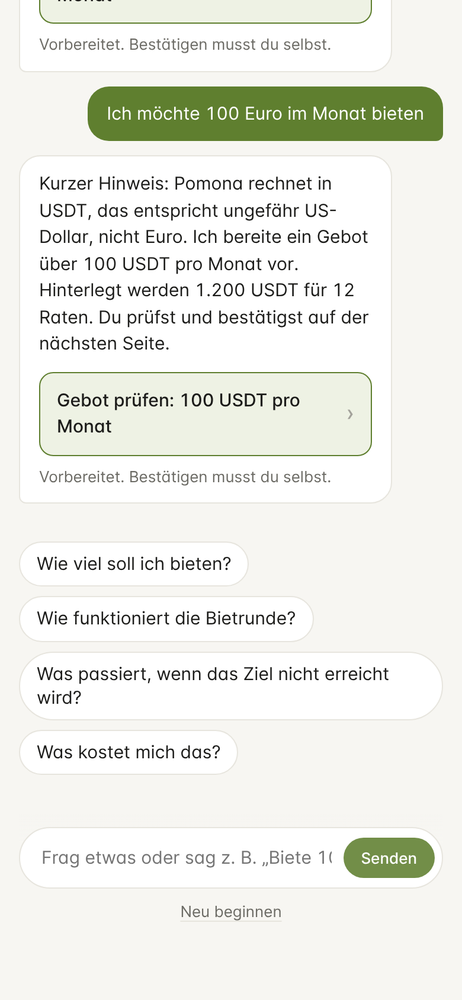

# Assistent „Frag Pomona“

Der Assistent ist eine Gesprächsschicht über der App. Er beantwortet Fragen in einfachen Worten und bereitet Schritte vor, etwa „Biete 100 im Monat“, „Zeig meinen Beleg für Rate 2“ oder „Rechnung stellen“. **Er führt nie selbst etwas aus.** Jede Aktion öffnet eine bestehende Seite der App, und die Person bestätigt dort wie gewohnt.

## Woher die Antworten kommen

| Reihenfolge | Quelle | Braucht Modell | Datei |
|---|---|---|---|
| 1 | **Vorschlag** (Knopf): geprüfter Text mit den aktuellen Zahlen | nein | `core/agent/knowledge.js` |
| 2 | **Befehl** (Regeln): „biete 100“, „aufladen“, „Beleg Rate 2“, „Rechnung stellen“, „zurückziehen“ | nein | `core/agent/intents.js` |
| 3 | **Sprachmodell** (QVAC) mit Werkzeugen für freie Fragen | ja | `core/agent/agent.js`, `tools.js`, `qvac.js` |
| – | Ohne Modell: Stichwortsuche im Wissen, sonst Angebot zur Einrichtung | nein | `knowledge.js` |

Damit funktioniert der Assistent sofort und auf schwachen Geräten. Das Sprachmodell kommt nur für freie Fragen dazu.

## Was das Modell darf

Die Werkzeuge (`core/agent/tools.js`) lesen oder bereiten nur vor:

| Werkzeug | Wirkung |
|---|---|
| `calculate_bid(amount)` | rechnet über `quoteBid`: Hinterlegung, Gebühr, ob das Guthaben reicht (nur lesen) |
| `prepare_bid(amount)` | Vorschlag „Gebot prüfen“, öffnet die Prüfseite |
| `open_page(page)` | Aufladen, Konto, Beleg prüfen, Beitreten, Runde starten |
| `show_receipt(installment)` | Beleg einer bezahlten Rate |
| `prepare_invoice()` | nur Organisator, nur wenn fällig |
| `prepare_withdraw()` / `prepare_refund()` | nur wenn möglich |
| `draft_news(text)` | nur Organisator; füllt das Feld, sendet nicht |

Jeder Vorschlag wird gegen Rolle, Phase und Status geprüft (`core/agent/actions.js`). Unbekannte Werkzeuge werden abgelehnt.

## Was das Modell sieht

`core/agent/context.js` baut den Systemprompt:
- **Regeln:** nichts behaupten, was nicht passiert ist, nie nach Passwort oder Passphrase fragen.
- **Hintergrundwissen** über Pomona.
- **Aktuelle Lage** als Fakten aus Contract und Wallet.

Texte anderer Peers (Titel, Neuigkeiten) werden bereinigt und als **Daten** eingezäunt. Das Modell soll darin stehende Anweisungen ignorieren. Selbst wenn es das nicht tut, kann es nur einen Vorschlag erzeugen, den die Person auf der Prüfseite sieht.

## Modelle (QVAC-Registry)

| Wahl | QVAC-Konstante | Größe |
|---|---|---|
| Kompakt | `QWEN3_1_7B_INST_Q4` | 1,1 GB |
| Genauer | `QWEN3_4B_INST_Q4_K_M` | 2,5 GB |

- **Download:** einmalig, peer-to-peer aus der QVAC-Registry, in den Speicher-Ordner des Workers (`models/`). QVAC prüft die SHA-256-Prüfsumme.
- **Danach** läuft alles offline im Bare-Worker (`@qvac/inference`, llama.cpp). Das Gespräch verlässt das Gerät nicht, wird nicht gespeichert und beim Sperren gelöscht.
- **Ohne Peer-to-Peer** (Firmennetz, Entwicklermodus): Die Modelldatei lässt sich auch von Hand herunterladen und in `modelsDir` legen (`~/pomona-models` in `npm run dev`). Pomona nimmt sie nur, wenn Größe und SHA-256 zum QVAC-Katalog passen, und lädt sie dann mit `modelType: llamacpp-completion` direkt. Siehe [DEV.md](DEV.md).
- **Andere Modelle:** In `MODELS` in `core/agent/qvac.js` lässt sich jede QVAC-Konstante eintragen, z. B. Qwen 3.5.

## Erweitern

- **Neue Frage:** einen Eintrag in `TOPICS` (`knowledge.js`) anlegen, mit Frage, Stichwörtern und Antwortfunktion, und ihn optional in `suggestions()` aufnehmen.
- **Neuer Befehl:** ein Muster in `matchIntent` (`intents.js`).
- **Neues Werkzeug:** Definition in `TOOLS` und Abbildung in `TO_ACTION` (`tools.js`), Prüfung in `validateAction` (`actions.js`), Umsetzung in der UI (`agent-act` in `ui/app.js`). Ein Werkzeug, das Geld bewegt, gehört **nicht** hierher.

## Tests

- `test/assistant.test.js`: Befehle, Wissen, Prüfung jeder Aktion, Abschirmung fremder Texte, Prompt-Injection-Szenario, keine Geld-Werkzeuge, Installation, Vergessen. Das Modell ist hier ein skriptbares Fake.
- `test/flow.test.js` („assistant on a real round“): echte Chain, echter `quoteBid`, Fake-Modell. Danach ist nachweislich kein Geld bewegt.
- `test/bare.test.js`: QVAC lädt in Bare (Konfiguration, llama.cpp-Plugin, Modell-Katalog), und der Assistent antwortet dort.

## Noch offen

- **Kein echtes Modell getestet:** In der Entwicklungsumgebung blockiert das Netz den P2P-Download der Modelle. Die Registry hat das Modell gefunden, der Download kam aber nicht an. Antwortqualität auf Deutsch, Geschwindigkeit und die Zuverlässigkeit der Tool-Aufrufe müssen auf einem echten Rechner geprüft werden.
- **Größe der Native-Addons:** Das QVAC-Addon für die eigene Plattform ist groß (Linux ca. 350 MB, Windows ca. 260 MB, macOS ca. 17 MB). Für die Verteilung über Pear sollte es später als optionaler Download nachgeladen werden, statt im App-Paket zu stecken. Außerdem enthält ein Pear-Release nur die Binärdateien der Plattform, auf der es gebaut wurde. Das muss beim Staging berücksichtigt werden.
- **Paket-Versionen:** `@qvac/inference` 0.22 erwartet `@qvac/llm-llamacpp` ^0.61 und `@qvac/langdetect-text` (wird beim Import geladen). Die Versionen sind im Lockfile fixiert.
